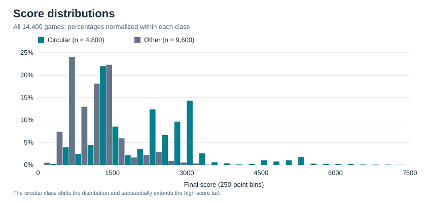
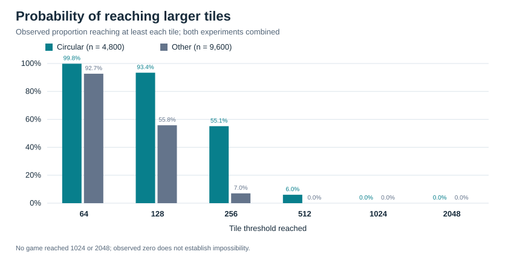
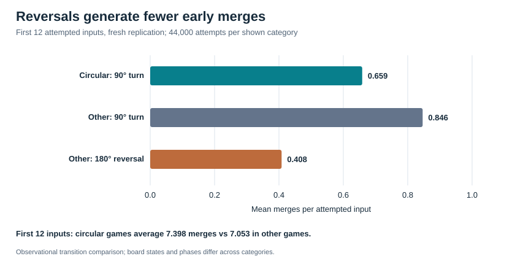

# 2048 Simulation Lab

A dependency-free implementation of standard 2048, designed as a foundation for studying and comparing solution strategies.

## Play

Clone the repository and open `index.html` in a modern browser. No build or package installation is required.

```sh
git clone https://github.com/abdullah-x-bd/2048_sim.git
cd 2048_sim
```

Alternatively, serve it locally with `python -m http.server 8000`, then visit http://localhost:8000.

Use arrow keys, WASD, touch gestures or the on-screen controls. The game continues after reaching 2048, and ends only when no legal moves remain. The displayed seed can be entered again to reproduce a game with the same sequence of actions.

## Rules

- 4 by 4 board; two random tiles initially.
- A tile can merge at most once per move.
- Each successful merge adds the resulting tile value to the score.
- Every valid move spawns one tile in a uniformly sampled empty cell: 2 with probability 0.9, 4 with probability 0.1.
- Invalid moves do not spawn tiles or consume random numbers.

## Engine for future solver research

`engine.js` works in both Node.js (CommonJS) and the browser, independently of the UI. Boards are arrays of four rows, with zero denoting an empty cell. All state transitions leave their inputs unchanged.

| Function | Purpose |
| --- | --- |
| `move(board, direction)` | Deterministic afterstate, gain and changed flag, without spawning |
| `legalMoves(board)` | Enumerate legal actions |
| `spawnOutcomes(board)` | Enumerate all possible spawn boards with exact probability weights (floating-point representation) |
| `spawn(board, rng)` | Sample a random tile and position |
| `createGame(rng)` | Initialise a game |
| `step(state, direction, rng)` | Execute a full game transition |
| `seededRng(seed)` | Reproducible uniform pseudorandom sequence |
| `maxTile(board)` | Highest tile |

```js
const E = require('./engine.js');
const rng = E.seededRng(42);
let state = E.createGame(rng);
state = E.step(state, E.legalMoves(state.board)[0], rng);
console.log(state);
```

The engine separates player actions from random environment transitions, so expectimax, Monte Carlo methods, heuristic search and reinforcement learning can all use the same rules. The initial version contains no solver.

## Research results: fixed repeating four-direction policies

The first two experiments evaluate all 24 permutations of up (0), left (1), right (2), and down (3), repeatedly and without adapting to the board. **Every attempted input is counted, even if the board does not change.** Standard tile-spawn probabilities and game termination are unchanged.

| Experiment | Seeds | Games | Results |
| --- | --- | ---: | --- |
| [01: exploratory](experiments/01-cyclic-permutations/) | 0 to 99 | 2,400 | 0 reached 2048 |
| [02: independent replication](experiments/02-cyclic-permutations-500/) | 100 to 599 | 12,000 | 0 reached 2048 |
| Combined | 0 to 599 | 14,400 | Highest tile 512; best score 7,256 |

### Central finding: the geometry of the cycle matters

The 24 patterns belong to two geometric classes under rotations and reflections of the square board: 8 circular cycles (alternating horizontal and vertical moves), and 16 other cycles (two opposite-direction reversals per period).

| Combined metric | Circular | Other |
| --- | ---: | ---: |
| Mean score | 2,288.81 | 1,098.64 |
| Median score | 2,324 | 1,072 |
| Mean valid moves | 197.10 | 119.49 |
| Reached tile 256+ | 55.13% | 7.02% |
| Reached tile 512+ | 6.02% | 0% |

All eight circular patterns ranked above all sixteen other patterns in both independent experiments. Circular policies achieved a higher class-average score on all 600 shared seeds. The fresh 500-seed paired score test gives t(499) = 62.42, p = 7.00e-238, Cohen's dz = 2.79, and a 95% mean advantage interval of [1,162.39, 1,237.95]. The circular class scored 2.09 times as high in replication. All six tested outcomes remain significant after Holm correction.







### Why might circular movement help?

Replaying the first 12 inputs of all 12,000 replication games reveals that reversals in the non-circular class produce 0.408 merges per input, compared with 0.846 for its perpendicular turns. Across the entire 12-input window circular games produce 7.398 merges versus 7.053, and preserve slightly more empty cells. Reusing the same row/column partition may redistribute tiles without creating as many new merge opportunities. This is evidence consistent with a mechanism, not a controlled causal proof.



Read the [full statistical analysis](experiments/02-cyclic-permutations-500/STATISTICAL_ANALYSIS.md), [paired seed differences](experiments/02-cyclic-permutations-500/figures/05-paired-differences.svg), [machine-readable statistics](experiments/02-cyclic-permutations-500/statistics.json), and [combined pattern summaries](experiments/02-cyclic-permutations-500/combined-summary.csv). All raw outcomes and attempted-step traces are retained.

The 14,400 games did not produce a 1024 or 2048 tile. This is a finite-sample result, not proof no such cycle can solve the game. Individual rankings within a geometric class are descriptive because the patterns are equivalent in distribution under ideal symmetric spawning.

### Reproduce the experiments and graphs

```sh
node experiments/01-cyclic-permutations/run.js
node experiments/01-cyclic-permutations/trace.js
node experiments/02-cyclic-permutations-500/run.js
node experiments/02-cyclic-permutations-500/statistics.js
node experiments/02-cyclic-permutations-500/figures.js
```

## Tests

With Node.js installed, run:

```sh
node engine.test.js
```

Tests cover the four movement directions, merging, score gains, spawn probabilities, invalid moves, winning, reproducibility, immutability and complete simulated games.
