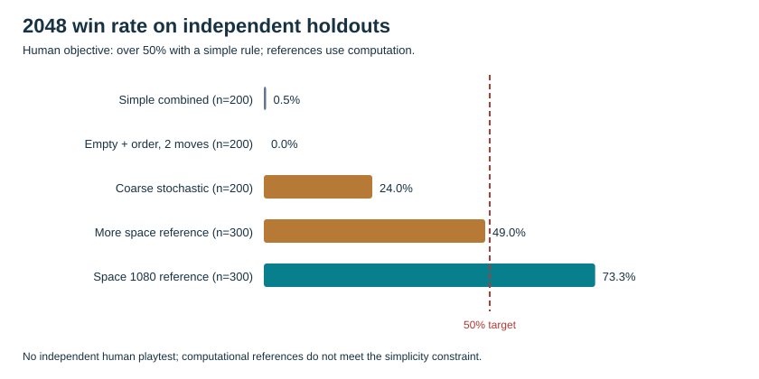
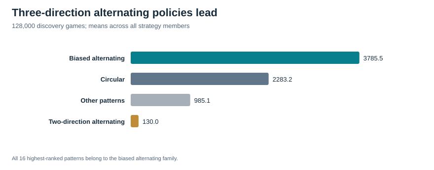
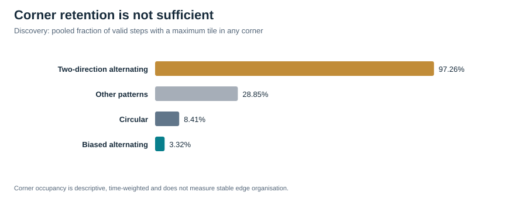
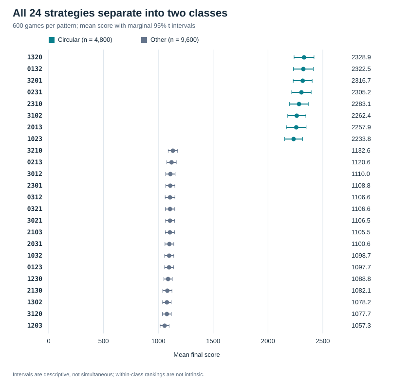
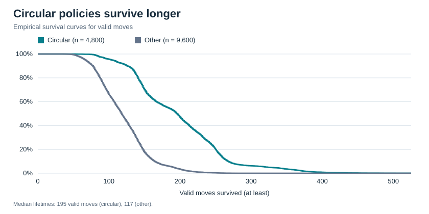

# 2048 Simulation Lab

A dependency-free implementation of standard 2048, designed as a foundation for studying and comparing solution strategies.

## Play

Clone the repository and open `index.html` in a modern browser. No build or package installation is required.

```sh
git clone https://github.com/abdullah-x-bd/2048_sim.git
cd 2048_sim
```

Alternatively, serve it locally with `python -m http.server 8000`, then visit http://localhost:8000.

Use arrow keys, WASD, touch gestures or the on-screen controls. The game continues after reaching 2048, and ends only when no legal moves remain. The displayed seed can be entered again to reproduce a game with the same sequence of actions.

## Rules

- 4 by 4 board; two random tiles initially.
- A tile can merge at most once per move.
- Each successful merge adds the resulting tile value to the score.
- Every valid move spawns one tile in a uniformly sampled empty cell: 2 with probability 0.9, 4 with probability 0.1.
- Invalid moves do not spawn tiles or consume random numbers.

## Engine for future solver research

`engine.js` works in both Node.js (CommonJS) and the browser, independently of the UI. Boards are arrays of four rows, with zero denoting an empty cell. All state transitions leave their inputs unchanged.

| Function | Purpose |
| --- | --- |
| `move(board, direction)` | Deterministic afterstate, gain and changed flag, without spawning |
| `legalMoves(board)` | Enumerate legal actions |
| `spawnOutcomes(board)` | Enumerate all possible spawn boards with exact probability weights (floating-point representation) |
| `spawn(board, rng)` | Sample a random tile and position |
| `createGame(rng)` | Initialise a game |
| `step(state, direction, rng)` | Execute a full game transition |
| `seededRng(seed)` | Reproducible uniform pseudorandom sequence |
| `maxTile(board)` | Highest tile |

```js
const E = require('./engine.js');
const rng = E.seededRng(42);
let state = E.createGame(rng);
state = E.step(state, E.legalMoves(state.board)[0], rng);
console.log(state);
```

The engine separates player actions from random environment transitions, so expectimax, Monte Carlo methods, heuristic search and reinforcement learning can all use the same rules. The initial version contains no solver.

## Experiment 07: simplified majority-winning policies

[Policy distillation and final holdout](experiments/07-policy-distillation/) adds 5850 completed game configurations, bringing the project total to 195,700. Sparse imitation of the 73.33% computational teacher failed in closed-loop testing. A coarse positional score and single hypothetical 2-spawn when the board has four or fewer empty cells produced four policies significantly above 50% on 300 fresh seeds each (Holm-adjusted exact tests). A two-candidate shortlist won 172/300 (57.33%; Wilson 95% CI 51.68% to 62.80%); probing was indicated on 36.90% of moves. A most-merges-next variant won 194/300 (64.67%; CI 59.10% to 69.86%). [Exact rules and data](experiments/07-policy-distillation/README.md).


These are compact computational rules, not a demonstrated casual human policy. Board arithmetic and hypothetical continuations remain; actual human win probability is untested. The original human objective remains open.

## Literature-guided research (Experiments 05 and 06)

[Experiment 06: literature review and benchmarks](experiments/06-literature-guided/) includes published human-oriented heuristic research, stochastic search, and learned afterstate evaluation. The project has 189,850 completed game configurations across all experiments. The first independently validated computational reference exceeding 50% is **space_1080: 220/300 wins (73.33%; Wilson 95% CI 68.06% to 78.02%)**. It uses weighted positional evaluation and stochastic lookahead, not a simple human policy. The best coarse stochastic holdout reaches 24%; the best simplified deterministic two-move holdout reaches 0.5%. The human objective remains unmet.



The strongest next research direction is to distill successful reference decisions into a short, visual decision list and evaluate its closed-loop win probability on fresh seeds. See the [literature review and full results](experiments/06-literature-guided/README.md).

## Human-followable strategy pilot (Experiment 04)

[Full pilot, rules, and raw traces](experiments/04-simple-human-policies-pilot/) tests 18 configurations on 1000 fresh shared seeds each. The project now has 184,400 simulated games (including behaviorally equivalent configurations).

**First 2048 successes:** a one-step corner-preserving, merge-count-first and snake-order tie-break rule achieved 2048 twice in 1000 games. Its mean score was 5562.31 and 11% reached 1024. The best blind-cycle recovery rule averaged 4665.73 but recorded zero wins. The new best final score is 27444. The winning rule is not yet a reliably successful strategy, and its exact numerical tie-break is not a tested human approximation. The next objective is maximizing 2048 success probability subject to simple, visually executable rules, rather than maximizing score.

## Experiment 03: all four-input words

[Experiment 03: exhaustive 256-pattern search and held-out validation](experiments/03-all-four-input-patterns/) expands the study to **128,000 discovery games and 24,000 held-out games**, bringing the cumulative project to **166,400 games**.

The 512 ceiling has been broken. The new experiments record 101 games reaching 1024 (100 biased alternating and one circular), but still no 2048 successes. The new best score is 14,052. Every one of the 16 highest-ranked discovery patterns uses three distinct directions, repeats one direction, omits its opposite and changes axis at every transition.

| Family | Discovery mean score | Held-out mean score | Held-out 512+ |
|---|---:|---:|---:|
| Biased alternating (e.g. 0102) | 3785.49 | 3786.19 | 29.525% |
| Circular (e.g. 0132) | 2283.17 | 2284.70 | 5.925% |

The held-out paired difference is 1501.50 points (95% CI [1455.42, 1547.57]), positive on 982 of 1000 shared seeds. Exact sign test p=2.546e-263 under the independent-seed model. Two-direction alternating policies stall in 100% of discovery games; biased alternating policies stall in 40.93% of holdout games. An omitted-direction recovery rule is the next proposed experiment.






The strongest family rarely keeps the largest tile in a corner. A hypothesis is that anchoring toward an edge, and sweeping in the perpendicular axis, improves interaction without sacrificing directional organization. This has not been established causally. No success at 2048 is not proof of impossibility. [Full methodology, results, files and reproduction](experiments/03-all-four-input-patterns/README.md).

## Research results: fixed repeating four-direction policies

The first two experiments evaluate all 24 permutations of up (0), left (1), right (2), and down (3), repeatedly and without adapting to the board. **Every attempted input is counted, even if the board does not change.** Standard tile-spawn probabilities and game termination are unchanged.

| Experiment | Seeds | Games | Results |
| --- | --- | ---: | --- |
| [01: exploratory](experiments/01-cyclic-permutations/) | 0 to 99 | 2,400 | 0 reached 2048 |
| [02: independent replication](experiments/02-cyclic-permutations-500/) | 100 to 599 | 12,000 | 0 reached 2048 |
| Combined | 0 to 599 | 14,400 | Highest tile 512; best score 7,256 |

### Central finding: the geometry of the cycle matters

The 24 patterns belong to two cyclic-geometric categories (three D4 orbits of ordered permutations, with the two non-circular orbits grouped): 8 circular cycles (alternating horizontal and vertical moves), and 16 other cycles (two opposite-direction reversals per period).

| Combined metric | Circular | Other |
| --- | ---: | ---: |
| Mean score | 2,288.81 | 1,098.64 |
| Median score | 2,324 | 1,072 |
| Mean valid moves | 197.10 | 119.49 |
| Reached tile 256+ | 55.13% | 7.02% |
| Reached tile 512+ | 6.02% | 0% |

All eight circular patterns ranked above all sixteen other patterns in both independent experiments. Circular policies achieved a higher class-average score on all 600 shared seeds. The fresh 500-seed paired score test gives t(499) = 62.42, p = 7.00e-238, Cohen's dz = 2.79, and a 95% mean advantage interval of [1,162.39, 1,237.95]. The circular class scored 2.09 times as high in replication. All six tested outcomes remain significant after Holm correction.







### Why might circular movement help?

Replaying the first 12 inputs of all 12,000 replication games reveals that reversals in the non-circular class produce 0.408 merges per input, compared with 0.846 for its perpendicular turns. Across the entire 12-input window circular games produce 7.398 merges versus 7.053, and preserve slightly more empty cells. Reusing the same row/column partition may redistribute tiles without creating as many new merge opportunities. This is evidence consistent with a mechanism, not a controlled causal proof.


Read the [full statistical analysis](experiments/02-cyclic-permutations-500/STATISTICAL_ANALYSIS.md), [paired seed differences](experiments/02-cyclic-permutations-500/figures/05-paired-differences.svg), [machine-readable statistics](experiments/02-cyclic-permutations-500/statistics.json), and [combined pattern summaries](experiments/02-cyclic-permutations-500/combined-summary.csv). All raw outcomes and attempted-step traces are retained.

The 14,400 games did not produce a 1024 or 2048 tile. This is a finite-sample result, not proof no such cycle can solve the game. Individual rankings are descriptive. D4-related patterns are equivalent in distribution under ideal symmetric spawning, but changing the initial phase need not be equivalent.

### Reproduce the experiments and graphs

```sh
node experiments/01-cyclic-permutations/run.js
node experiments/01-cyclic-permutations/trace.js
node experiments/02-cyclic-permutations-500/run.js
node experiments/02-cyclic-permutations-500/statistics.js
node experiments/02-cyclic-permutations-500/figures.js
```

## Tests

With Node.js installed, run:

```sh
node engine.test.js
```

Tests cover the four movement directions, merging, score gains, spawn probabilities, invalid moves, winning, reproducibility, immutability and complete simulated games.
