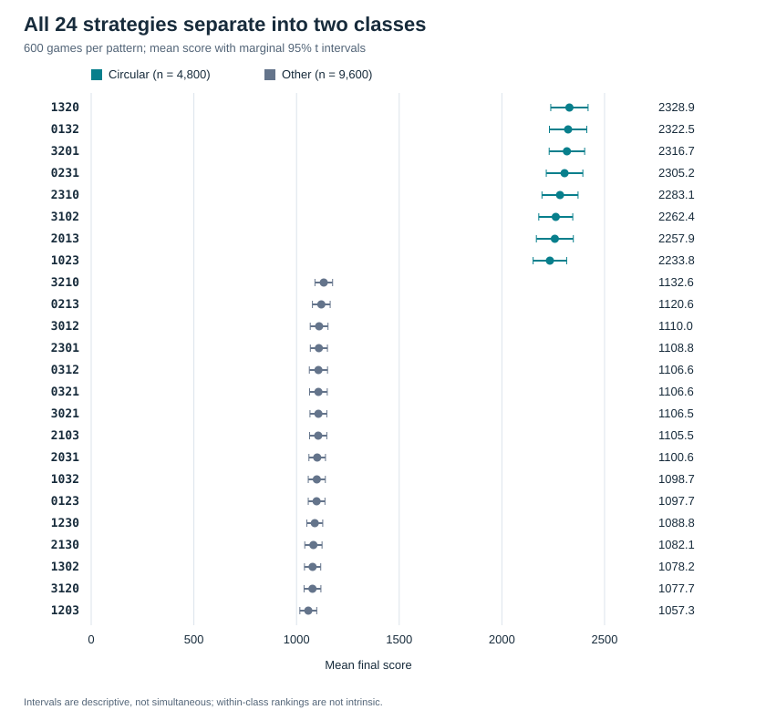
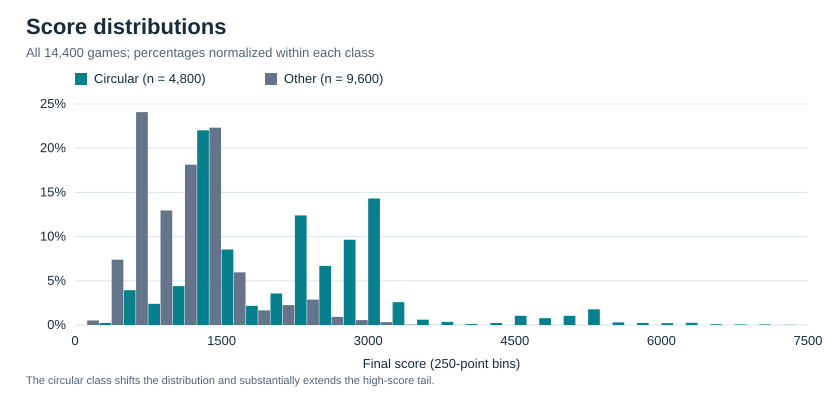
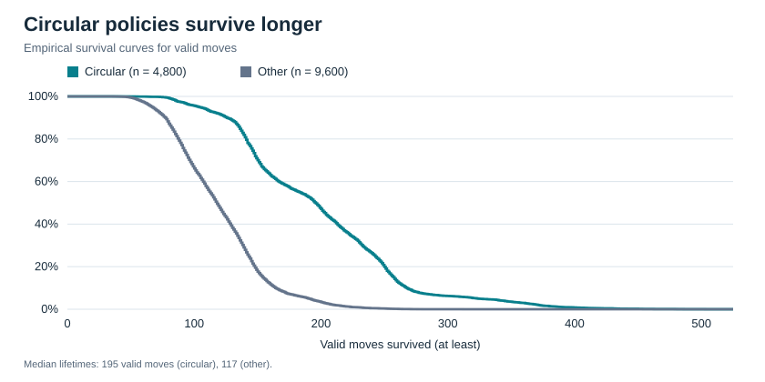
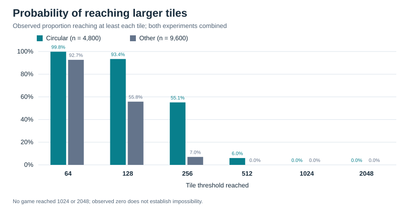
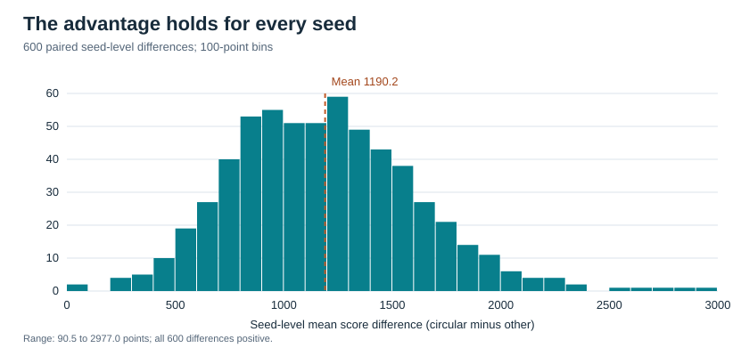
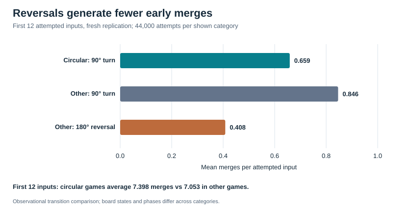

# Experiment 02: Fixed cycles, 500-game replication

This experiment repeats the protocol from Experiment 01 using 500 **new** seeds (100 through 599) per pattern. The original 100 seeds are retained separately. There are 12,000 new games and 14,400 total games across both experiments.

Direction codes: 0 up, 1 left, 2 right, 3 down. Each of the 24 permutations is repeated until terminal. Every attempted input advances the cycle, including unchanged board steps, which consume no randomness and spawn no tile. Each trace contains one binary character per attempted step (1 = changed, 0 = unchanged); the attempted direction at zero-based index i is pattern[i % 4].

## Findings

| Metric | Original | Replication | Combined |
|---|---:|---:|---:|
| Games | 2400 | 12000 | 14400 |
| Mean score | 1478.34 | 1498.77 | 1495.36 |
| Best score | 6812 | 7256 | 7256 |
| Reached 512 | 43 | 246 | 289 |
| Reached 1024 | 0 | 0 | 0 |
| Reached 2048 | 0 | 0 | 0 |
| Attempted inputs | 352103 | 1779126 | 2131229 |
| Unchanged inputs | 6166 | 31847 | 38013 |

The eight circular patterns again occupy the top eight ranks. In the fresh replication, their mean score is 2298.884 versus 1098.7125 for the other 16 patterns, a ratio of 2.09234. The seed-paired mean difference is 1200.1715, with a 95% t interval of [1162.39, 1237.95], treating the 500 seed-level differences as observations. Combined ratio: 2.08330. The highest-scoring game was pattern 2013, seed 535, with 7256 points and a 512 tile.

No success was observed, but finite sampling does not prove impossibility. Patterns within a geometric class are equivalent in distribution under symmetric random spawning; the empirical ranking is descriptive. Pattern-level confidence intervals are marginal; the class comparison uses seed-level paired differences because the same seeds are reused across patterns.

## Files and reproduction

Run `node experiments/02-cyclic-permutations-500/run.js` from the repository root. The runner reads the original games.csv and writes all replication files. No dependencies are required.

- games.csv: 12000 individual outcomes.
- summary.csv: 24 strategy summaries for the new sample.
- combined-summary.csv: 24 strategy summaries across all 600 seeds.
- analysis.json: overall and geometric-class comparisons.
- traces-01.csv to traces-06.csv: 12000 game traces, split into six files containing four patterns each.

The simulations were executed against the repository engine and the results were committed to main. This is not a GitHub Actions run.

## Extended statistical analysis

See [STATISTICAL_ANALYSIS.md](STATISTICAL_ANALYSIS.md) for all six paired tests, Holm correction, effect sizes, exact sign test, distribution quantiles, shared-seed handling, and an early-board mechanism replay. The fresh class score advantage is positive on all 500 seeds, and across both experiments on all 600 seeds. The early replay covers 144,000 attempts; reversal transitions generate substantially fewer merges than perpendicular transitions in the non-circular class.

Regenerate with `node experiments/02-cyclic-permutations-500/statistics.js` and `node experiments/02-cyclic-permutations-500/figures.js`. Machine-readable output: [statistics.json](statistics.json).
