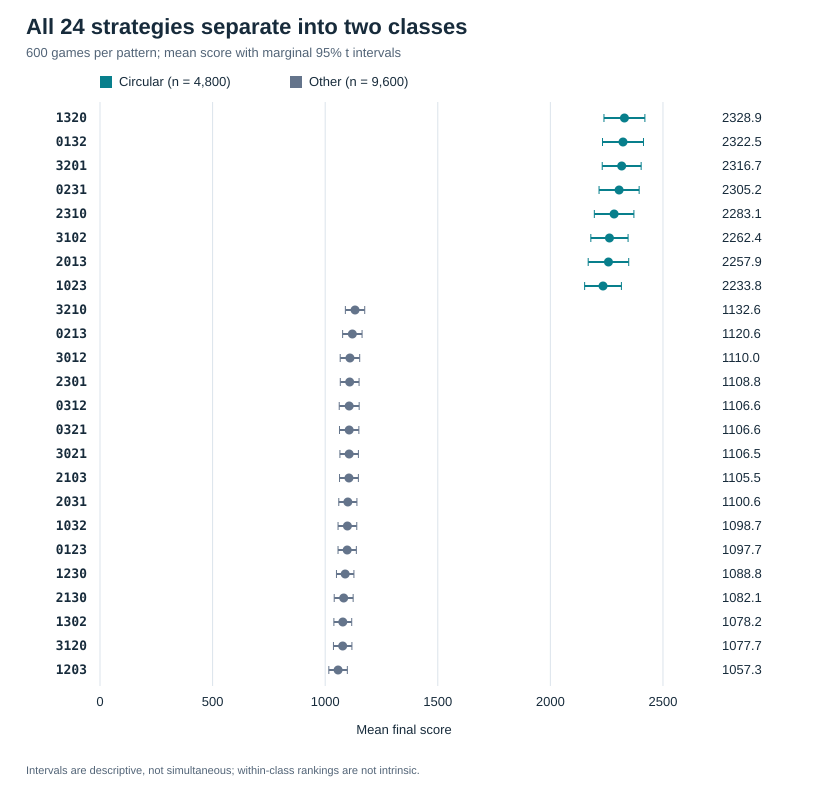
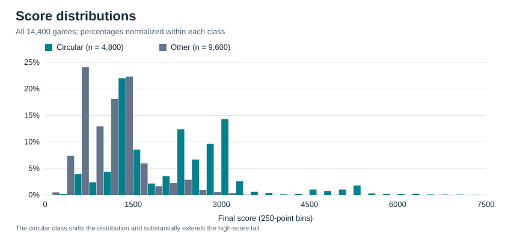
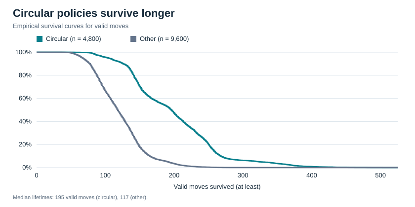
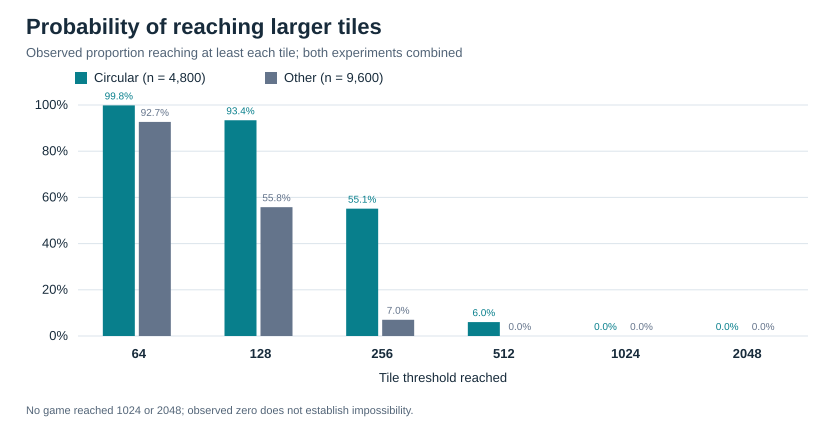
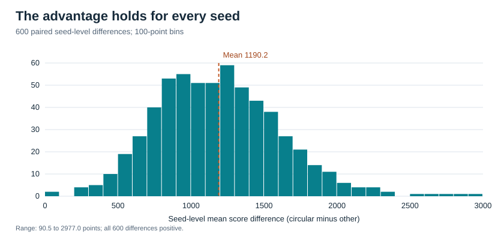
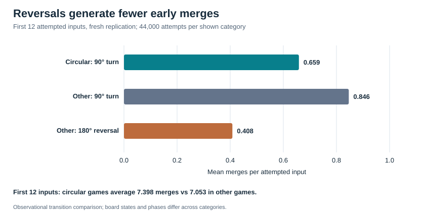

# Statistical analysis: fixed four-direction cycles

## Study design and inferential unit

The full dataset contains 14,400 games, 24 patterns and 600 shared seeds. Experiment 01 (100 seeds) was exploratory; experiment 02 (500 new seeds) is the replication. Both experiments use the exact same engine and policy definitions: 0 up, 1 left, 2 right, 3 down; the next attempted input always advances the phase, even for an unchanged board. The game runs until terminal, including after 2048 if it is reached. The combined sample has 2,131,229 attempted inputs, of which 38,013 did not change the board.

Direction permutations form three ordered-word D4 orbits; grouping by cyclic phase yields two geometric categories: eight circular orders (all transitions are 90-degree turns) and sixteen other orders (two turns and two reversals per four-step cycle). All patterns within a D4 orbit have the same distribution under the ideal symmetric spawning model; initial phase shifts need not preserve that distribution. The finite pseudorandom simulations need not be identical under rotation because empty cells are indexed in row-major order.

For each seed, compute the mean outcome across the eight circular patterns and across the sixteen other patterns, then subtract. Tests use these seed-level differences, not individual games as independent observations. The fresh replication is the primary analysis; combined estimates are descriptive and confirmatory of consistency but should not be counted as a third independent experiment. The t intervals and tests presume approximately independent draws of seed-level differences from the intended random environment; sequential deterministic PRNG seeds are a computational approximation to that model. All six fresh paired t tests use Holm correction. Sign tests provide a nonparametric check. The geometric mechanism analysis is exploratory.

## Main results

| Outcome (fresh replication) | Circular | Other | Difference (95% paired CI) | Two-sided paired t p | Holm p |
|---|---:|---:|---:|---:|---:|
| Score | 2298.884 | 1098.713 | 1200.172 [1162.39, 1237.95] | 7.00e-238 | 2.80e-237 |
| Valid moves | 197.772 | 119.524 | 78.248 [75.93, 80.57] | 1.88e-249 | 9.38e-249 |
| Reached 256+ | 55.525% | 7.1125% | 48.413 pp [46.64, 50.18] | 1.15e-209 | 3.44e-209 |
| Reached 512+ | 6.15% | 0% | 6.15 pp [5.33, 6.97] | 1.92e-41 | 1.92e-41 |
| Score/valid move (game-level mean) | 11.101 | 8.755 | 2.346 [2.279, 2.412] | 1.18e-258 | 7.08e-258 |
| Invalid input fraction (game-level mean) | 1.2421% | 2.0563% | -0.814 pp [-0.867, -0.762] | 1.08e-115 | 2.15e-115 |

Score effect: t(499)=62.415, Cohen's dz=2.791. Circular class mean score is 2.092 times the other class in the replication and 2.083 times across both cohorts. Circular scores won on every fresh seed (500/500, exact two-sided sign p=6.11e-151), and every combined seed (600/600, p=4.82e-181). The minimum combined difference was 90.5 points and maximum was 2977.0 points. These are class-average comparisons, not claims about individual paired games.

The eight circular patterns occupy the top eight ranks in both independent cohorts. The top observed pattern changes from 0132 to 1320, consistent with sample variation among theoretically symmetric policies. In the combined sample, mean scores range from 2233.78 to 2328.87 within the circular class, versus 1057.27 to 1132.61 among other patterns. Ranking D4-equivalent individual strategies as intrinsically distinct is unjustified under ideal symmetry; the two non-circular D4 orbits should not be assumed equivalent across phases.

## Distributions

| Combined outcome | Circular (4800 games) | Other (9600 games) |
|---|---:|---:|
| Mean score | 2288.81 | 1098.64 |
| Score SD | 1091.01 | 519.56 |
| Median score | 2324 | 1072 |
| Score 25th percentile | 1408 | 688 |
| Score 75th percentile | 2976 | 1372 |
| Score 95th percentile | 4684.2 | 2232 |
| Median valid moves | 195 | 117 |
| 90th percentile valid moves | 267 | 163 |
| Reached 256+ | 2646/4800 (55.125%) | 674/9600 (7.021%) |
| Reached 512+ | 289/4800 (6.021%) | 0/9600 |
| Reached 1024+ | 0 | 0 |
| Reached 2048+ | 0 | 0 |

The circular class's first quartile exceeds the other class's third quartile. The circular class's 95th-percentile score exceeds every observed score in the other class (maximum 3880). Both class distributions are right-tailed and overlap; the dominance is statistical, not pointwise. In the combined data, circular games have 64.95% more valid moves and higher mean score per valid move (11.095 vs 8.755, +26.73%). The pooled score/total-valid-moves ratio is 11.612 vs 9.194; these pooled rates differ from unweighted means of game-level ratios. Lifetime and reward efficiency are related outcomes, not independent causal effects.











## Potential explanations: early-game replay

Replay the first 12 inputs of each fresh game (144,000 attempted inputs). No game can end during this window: even without merges, two starting tiles and at most 12 spawns cannot fill 16 cells. The first direction is excluded from transition comparisons, giving three groups of 44,000 attempts each. A reversal is an attempted 180-degree change from the previous input; a turn is a 90-degree change. The previous input need not have changed the board.

| Transition | Mean merges/attempt | Mean score gain/attempt | Probability board changes |
|---|---:|---:|---:|
| Circular turn | 0.6586 | 3.9235 | 99.45% |
| Other-pattern turn | 0.8464 | 4.7075 | 99.40% |
| Other-pattern reversal | 0.4082 | 2.5707 | 99.88% |



The reversal produces 51.8% fewer merges per input than the other-pattern turn, despite being slightly more likely to change the board. Other-pattern turns themselves merge more than circular turns; therefore the evidence does not justify claiming every circular turn is intrinsically superior. Non-circular turns may benefit from backlog accumulated during reversals, but that is a hypothesis. Circular patterns show better net performance over the complete early window:

| First 12 inputs per game | Circular | Other | Seed-paired difference (95% CI) |
|---|---:|---:|---:|
| Number of merges | 7.398 | 7.053 | 0.345 [0.300, 0.389] |
| Mean empty cells after each input | 11.122 | 10.904 | 0.218 [0.200, 0.236] |
| Score | 43.775 | 40.646 | 3.129 [2.676, 3.582] |

A reversal reuses the same row or column partition. Compaction alone cannot create new relative ordering within those lines, although previous merges, new tile spawns and merges on the reversal can change the situation. A perpendicular move redistributes tiles between the previous lines and may bring previously separated equal tiles together. This supplies a plausible structural explanation for the observed merge-rate differences, not a demonstrated state-controlled causal mechanism.

Let O_t denote occupied cells, I_t indicate a changed board, and M_t denote the merge count. The exact occupancy identity is O_(t+1)=O_t+I_t-M_t. Every terminal board is full, starts with two occupied cells, and therefore total merges = valid moves - 14. Consequently the combined circular class underwent 183.10 merges per game on average, versus 105.49 for the other class. This is a deterministic accounting relationship, not an independent statistical discovery. The early fixed-horizon replay gives separate evidence before terminal lifetime differences are established.

Open hypotheses: repeated reversals consume new tiles without creating enough merge opportunities; perpendicular turns redistribute matching tiles more efficiently; circular order may improve the distribution of empties and long-run access to large tiles. Test these by evaluating all four actions on the identical afterstates, estimating one-step and multi-step merge opportunities, tracking fragmentation and corner stability, and comparing longer periods with intermediate reversal fractions. Existing transition categories are not state matched and cannot identify a causal mediation effect.

## What zero wins means

No 1024 or 2048 tile occurred in 14,400 games. In the ideal independent-seed sampling model, observing zero wins for a specified pattern over 600 seeds gives a one-sided exact 95% upper bound of 1 - 0.05^(1/600) = 0.498% on its win probability. The same 0.498% upper bound applies to the probability that any tested pattern wins on a randomly sampled seed, when the outcome is aggregated into 600 seed blocks. It is not valid to treat all 14,400 shared-seed games as independent and use a pooled rule of three. No claim of mathematical impossibility is established.

## Reproduce

From the root:

```sh
node experiments/01-cyclic-permutations/run.js
node experiments/01-cyclic-permutations/trace.js
node experiments/02-cyclic-permutations-500/run.js
node experiments/02-cyclic-permutations-500/statistics.js
node experiments/02-cyclic-permutations-500/figures.js
```

The analysis checks unique pattern/seed combinations, balance (8 circular and 16 other per seed), and attempted = valid + invalid. Detailed p values, effect sizes, quantiles, confidence intervals and early replay summaries are in statistics.json. Graphs are generated as SVG using the dependency-free figures.js.
