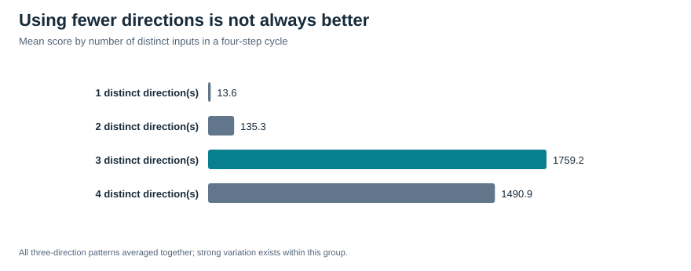
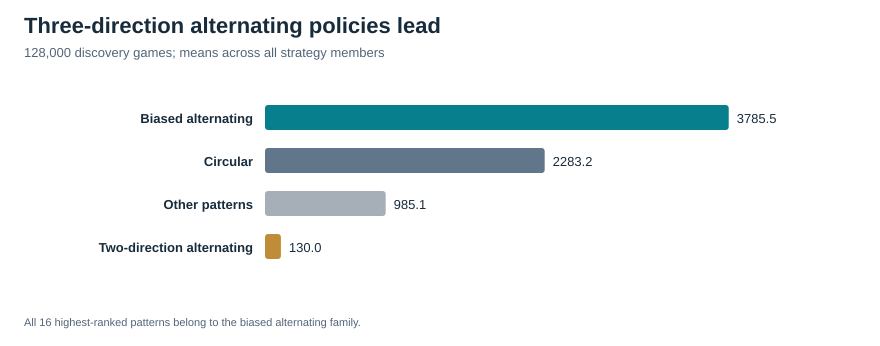
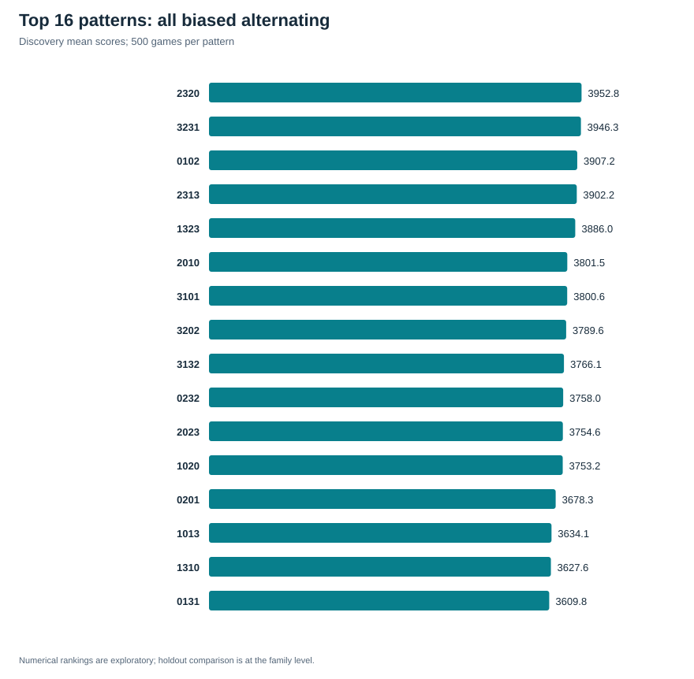
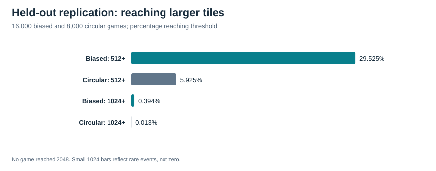
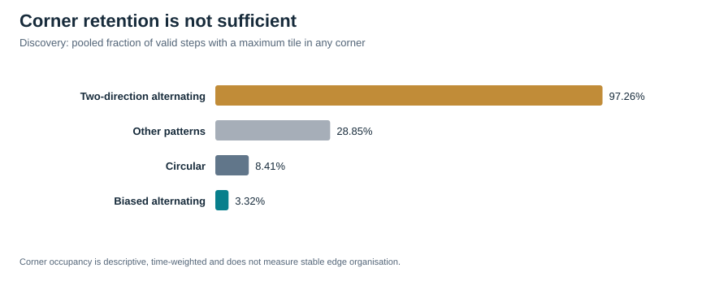

# Experiment 03: Exhaustive four-input periodic policies

## Research question

Does directional asymmetry improve performance when perpendicular transitions are retained? Can a restricted fixed policy exceed the previously observed 512 ceiling?

## Design

- All 256 ordered words of length four over {0,1,2,3}, including repetition. Codes: 0 up, 1 left, 2 right, 3 down.
- 500 new seeds (600 to 1099) per word; 128,000 discovery games. Every strategy starts at its first symbol. Words with smaller fundamental periods are retained.
- Holdout: all 16 three-direction alternating patterns and all eight circular patterns, each on 1000 new seeds (1100 to 2099); 24,000 further games.
- Unchanged inputs advance the phase, consume no randomness and produce no tile. Terminate on true game over, or after four consecutive unchanged inputs (policy stagnation). Since the next four directions and unchanged board repeat exactly, no future input from that policy can change the board.
- The optimized lookup-table engine shares the reference seed generator, spawn order and mechanics. All result fields and invalid-input indices matched the original engine in 768 reference replays (three seeds for every word). This is regression validation, not an exhaustive proof; the engine aborts on exponent overflow or an unexpected million-input limit. Neither limit was encountered.
- Each game CSV row includes attempts and base-36, dot-separated **one-based** indices of invalid inputs. All other indices are changed inputs; direction at index i is pattern[(i-1)%4]. Thus every attempt can be reconstructed without losing unchanged events. The state can be replayed from the seed. Corner_steps counts post-spawn valid states in which any maximum tile occupies any corner; empty_sum is the sum of post-spawn empty cells on valid steps. first2048 is zero if never reached; otherwise it is the first attempted input index reaching the tile.

## Exhaustive results

128,000 games; 16,838,953 attempted inputs; 14,947,320 valid moves; 1,891,633 unchanged inputs. 50,260 ended by stagnation. No 2048 tiles; 37 games reached 1024, all in the biased alternating family. Best score: 13,296 (3202, seed 793; 821 valid moves, 913 attempts).

| Distinct directions | Patterns | Games | Mean score | 1024+ | Stagnation |
|---|---:|---:|---:|---:|---:|
| 1 | 4 | 2,000 | 13.554 | 0 | 100% |
| 2 | 84 | 42,000 | 135.341 | 0 | 99.757% |
| 3 | 144 | 72,000 | 1759.212 | 37 | 8.836% |
| 4 | 24 | 12,000 | 1490.934 | 0 | 0% |



| Structural family | Patterns | Mean score | Mean valid moves | 512+ | 1024+ | Stagnation |
|---|---:|---:|---:|---:|---:|---:|
| Biased alternating | 16 | 3785.487 | 294.140 | 29.7375% | 0.4625% | 41.45% |
| Circular | 8 | 2283.171 | 196.594 | 5.475% | 0% | 0% |
| Two-direction alternating | 8 | 129.960 | 22.334 | 0% | 0% | 100% |
| All remaining | 224 | 985.085 | 104.629 | 0.5232% | 0% | 38.34% |



The best 16 patterns are exactly the 16 biased alternating words, with one direction repeated twice, its opposite omitted, and the other two directions each occurring once. All four cyclic transitions are perpendicular. The circular family also has four turns but no direction preference. Within the three-direction group, two turns plus one reversal and one repeat average 1556.67 points, while two turns plus two reversals average 1353.69. Zero reversals alone is not sufficient: two-direction alternating policies stagnate after just 22.33 valid moves on average.



## Held-out validation

All 24,000 additional games completed. The biased alternating group scored 3786.191 versus 2284.695 for circular, a 65.72% advantage. Compare the class means for each seed, not individual games as independent replicates. The paired mean difference is 1501.496 (95% t CI [1455.42, 1547.57], t(999)=63.9444, Cohen's dz=2.0221). The biased family wins 982 of 1000 seed blocks; the exact two-sided sign p=2.546e-263, assuming independent seed blocks and equal win/loss probabilities under the null. Discovery was 490/500. The holdout interval and score comparison confirm the discovered family rather than the best individual pattern. Secondary outcomes are descriptive/exploratory; marginal CIs are not simultaneous.

| Metric | Biased alternating | Circular |
|---|---:|---:|
| Games | 16,000 | 8,000 |
| Mean score | 3786.191 | 2284.695 |
| Mean valid moves | 294.223 | 196.541 |
| Reached 512+ | 4724 (29.525%) | 474 (5.925%) |
| Reached 1024+ | 63 (0.39375%) | 1 (0.0125%) |
| Reached 2048 | 0 | 0 |
| Stagnated | 40.93125% | 0% |
| Mean game-level corner fraction | 4.8004% | 8.3704% |



One circular policy (3201) also reached 1024 in holdout. The 101 1024 attainment events across discovery and holdout consist of 100 biased and one circular. The highest score in holdout was 14,052 (3101, seed 1776; 851 valid moves and 953 inputs). All 152,000 new games combined have zero 2048 wins; a finite sample cannot prove impossibility. Shared seeds and selection must be considered before computing rare-event bounds.

## What did we learn?

1. **An intermediate directional preference works best in this search.** The best family has a bias magnitude of 0.5, perpendicular transition ratio of 1, and exactly three distinct directions. This is not evidence that the same numerical bias optimizes all longer policies.
2. **Corner anchoring alone is not the explanation.** The pooled valid-step corner fraction in discovery was 3.322% for biased alternating, 8.406% circular and 97.255% for two-direction alternating. The best family may instead use an edge as an anchor while sweeping in both orthogonal directions. This is a hypothesis: no edge-position diagnostic or state-matched intervention has yet established it. Corner occupancy does not measure monotonicity or persistent organization.
3. **Stagnation is a major intervention opportunity.** 40.93% of biased holdout runs end with the board still admitting a legal move outside the three-direction action set. Such a legal move must be the omitted fourth direction. A minimal adaptive strategy can inject that direction once after a full unchanged cycle and return to its base pattern. Score and 2048 attainment must be tested on fresh paired seeds, including any new stalls and terminal outcomes. This is proposed, not yet run.
4. **Excess bias restricts exploration.** Two-direction fixed policies almost always stall, even while many empty cells remain. A low reversal rate alone is not an adequate predictor. In the 256-word search, the combination of axis alternation, coverage and bias is more informative than any single feature.



## Symmetry and phase

D4 acts by relabeling directions; it gives 36 orbits of ordered four-symbol words (Burnside's lemma: (256+16+16)/8=36). For all-four-distinct words there are three D4 orbits, not two; the two non-circular orbits collapse only if cyclic phase shifts are also allowed. Since the game starts at a specified input, phase shifts are not automatically distributionally equivalent. The 16 biased alternating words similarly form two D4 orbits depending on whether the initial direction is the repeated direction or a sweep direction. Held-out mean scores were 3778.931 and 3793.451 respectively; this is descriptive, not a proof of equivalence. All phase variants were retained in the experiment.

## Reproduction and files

Run from the repository root:

```sh
node experiments/03-all-four-input-patterns/run.js
node experiments/03-all-four-input-patterns/structural-analysis.js
node experiments/03-all-four-input-patterns/validate.js
node experiments/03-all-four-input-patterns/figures.js
```

- games-01.csv through games-16.csv: 128,000 complete outcome and compressed trace records.
- summary.csv: all 256 pattern summaries, one row per pattern. summary-part-01.csv through summary-part-04.csv are intermediate summaries from execution batches.
- structural-summary.json: grouped performance by direction count, bias, reversal, repetition, and turn counts.
- holdout-games-01.csv through holdout-games-04.csv: 24,000 validation game records.
- holdout-summary.csv and validation.json: 24 patterns, paired intervals, effect sizes and sign tests.
- run.js, structural-analysis.js, validate.js and figures.js: reproducible scripts.
- figures/: five generated SVG plots.

The computation ran in the assistant's JavaScript environment using the repository engine, not GitHub Actions; data and code are committed to main. Graphs were generated programmatically; browser rendering was not separately verified.
