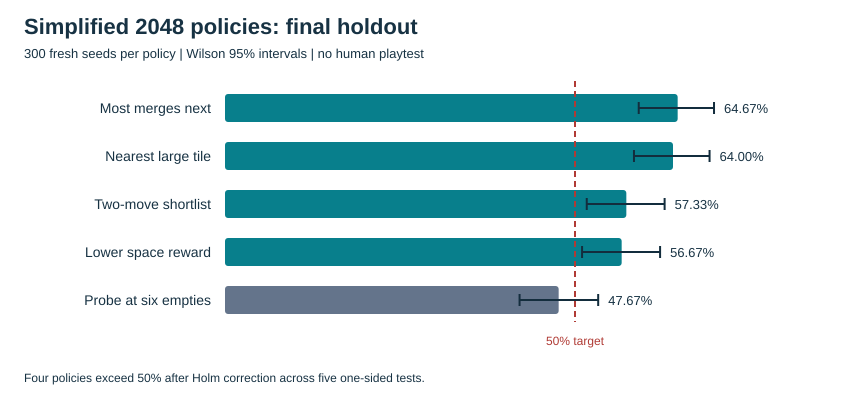

# Experiment 07: Policy distillation and simpler majority-winning rules

## Objective

Find a human-followable policy achieving more than 50% wins. A win is reaching tile 2048. All new games stop on a win or game over. Compact computational policies with high win rates are progress, but do not by themselves establish an easy human strategy.

## Imitation of successful decisions

The teacher is the Experiment 06 space_1080 benchmark (220/300 wins). Its earlier holdout becomes development data here. We replayed 80 games and verified scores and end tiles. Every twentieth decision with multiple legal moves yielded 3079 training positions from 60 games and 1031 comparison positions from another 20. The pairwise logistic ranking model fits the teacher's chosen action against competing legal actions.

| Model | Comparison agreement | Closed-loop wins |
|---|---:|---:|
| Three visual features | 50.44% | 0/200 |
| Four visual features | 59.75% | 0/200 |
| Expanded immediate features | 65.66% | 1/200 |
| Two-move features, no spawn | 66.05% | 1/200 |
| Small spawn-aware features | 73.81% | 0/50 |
| Full spawn-aware features | 74.20% | 21/50 |

Agreement does not guarantee closed-loop performance. Mistakes may accumulate and lead the student into states rarely encountered by the teacher; that explanation is plausible rather than causally established.

## Coarse positional evaluation

For each of four rows and four columns, count empty cells; remove zeros for the purpose of counting every tile in equal-value runs of length at least two; and calculate an ordering penalty. For the ordering calculation, include all four positions, including zeros. Map tiles to these weights:

| Tile | 0, 2, 4 | 8, 16 | 32, 64 | 128, 256 | 512, 1024 | 2048 |
|---|---:|---:|---:|---:|---:|---:|
| Weight | 0 | 1 | 2 | 4 | 8 | 16 |

Sum positive adjacent weight increases and positive adjacent decreases separately on each line; take their minimum as the line's penalty. Let E be the number of empty board cells, P be the sum of equal-run tile counts across eight lines, D the sum of line penalties. The grouped evaluation is H = 8E + 3P - 2D. The lower-space version is H = 6E + 3P - 2D. The code counts empties twice (row and column), hence the factor of two. P is merge potential, not the guaranteed number of merges. Earlier coarse versions use weights [0,0,0,1,1,2,3,5,8,12,18,26] for tile exponents 0 through 11.

## Candidate with lowest forecast branching: shortlist_at_4

1. Take a winning action immediately if possible.
2. Evaluate the deterministic afterstate (before random spawn) of each legal move with H. If the current board has more than four empty cells, choose the highest-H action.
3. Otherwise shortlist the two highest-H actions. For each, imagine a single 2 spawning in the empty cell with the largest sum of orthogonally adjacent tile exponents (log2 tile value, zero for empty). Break cell ties in row-major order. Evaluate the best legal continuation with H. Select the original action maximizing H_immediate + 9 H_following. If the hypothetical state has no legal move, continuation value is its H minus 100000. Action ties use up, left, right, down.

Other final variants: nearest_at_4 probes all legal options, using the maximum adjacent exponent rather than the sum to select the spawn. merge_next_at_4 probes all legal options using the sum risk, then selects the continuation creating the most empty cells, breaking ties by H. grouped_single_4_lower_space uses H = 6E + 3P - 2D, all legal candidates and best-H continuation. grouped_single_6 uses the standard grouped score and single probe at six empty cells.

These are exact computational descriptions; they require arithmetic and mental simulation. A qualitative approximation has not been tested. The imagined spawn is a proxy, not a guarantee.

## Completed screening and validation

| Phase | Seeds | Games |
|---|---|---:|
| Fast imitation | 4300 to 4499 | 800 |
| Spawn imitation | 4300 to 4349 | 100 |
| Coarse screening | 4500 to 4549 | 450 |
| Two-probe holdout | 4600 to 4899 | 300 |
| Adaptive screening | 4900 to 4949 | 550 |
| Adaptive holdout | 5000 to 5299 | 1200 |
| Grouped screening | 5300 to 5349 | 550 |
| Shortlist screening | 5350 to 5399 | 400 |
| Final holdout | 5400 to 5699 | 1500 |
| Total | | 5850 |

Games are policy-seed configurations. Policies in a batch share seeds; the first two screens overlap seed ranges. All other phase ranges are disjoint.

Unconditional coarse two-probe policy: 217/300 wins (72.33%, Wilson 95% CI 67.01% to 77.09%). It tests a 2 in the most and least exposed empty positions separately and averages continuation scores.

| Adaptive policy | Wins / 300 | Rate | Wilson 95% CI |
|---|---:|---:|---:|
| One probe at <=4 empties, original coarse weights | 193 | 64.33% | 58.76% to 69.54% |
| Two probes at <=4, original coarse weights | 211 | 70.33% | 64.93% to 75.22% |
| Two probes at <=2, original coarse weights | 144 | 48.00% | 42.41% to 53.64% |
| Grouped weights, two probes at <=6 | 197 | 65.67% | 60.13% to 70.81% |

## Final independent holdout, 300 new seeds per candidate

| Policy | Wins | Rate | Wilson 95% CI | Holm p (one-sided vs 50%) | Probe turns | Probe candidates / move |
|---|---:|---:|---:|---:|---:|---:|
| merge_next_at_4 | 194 | 64.67% | 59.10% to 69.86% | 0.00000106 | 35.42% | 1.255 |
| nearest_at_4 | 192 | 64.00% | 58.42% to 69.22% | 0.00000284 | 33.75% | 1.198 |
| shortlist_at_4 | 172 | 57.33% | 51.68% to 62.80% | 0.01937 | 36.90% | 0.738 |
| grouped_single_4_lower_space | 170 | 56.67% | 51.01% to 62.15% | 0.02418 | 36.41% | 1.302 |
| grouped_single_6 | 143 | 47.67% | 42.08% to 53.31% | 0.80675 | 69.71% | 2.501 |

Four candidates reject the one-sided null p <= 0.5 at 5% after Holm correction across five final policies. Wilson intervals are marginal. Statistical inference treats seeds as an approximation to independent random game environments. All 1500 final traces were replayed and checked for legal moves, score, tile and length. Probe effort is a proxy: on non-immediately-winning turns count the number of candidate actions requiring a hypothetical spawn check. It does not measure human time or follow-up move evaluations. No between-policy significance claim is made.

## Conclusions

Simple imitation failed; explicit anticipation of a single awkward spawn was much more promising. Four empty cells appears to be a useful trigger; waiting until two was too late in the tested coarse variant. The two-candidate shortlist minimizes forecast branching among these final variants, while the most-merges-next policy has the highest observed grouped-policy win rate. This is a descriptive trade-off.

The original human objective remains open: a compact policy with arithmetic over eight lines and hypothetical moves has not been demonstrated to be an easy human strategy. Test concise visual approximations and human adherence independently before claiming a practical >50% human policy.

## Reproduction

The modules features.js, distill.js, coarse.js, adaptive-probes.js, grouped.js and shortlist.js contain the feature extractors, fitted-model routines and exact candidate policies. models.json contains fitted parameters and comparison agreement. audit.js verifies traces and calculates effort. CSVs contain the 5850 individual new outcomes and action traces; final-holdout-summary.csv and threshold-tests.json contain statistical results. Run the supplied run.js from repository root to rerun the experiment. No human playtesting was performed.
