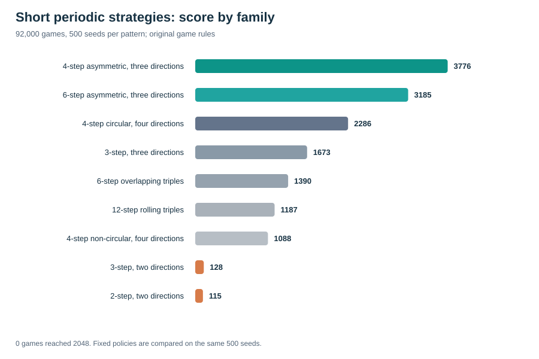
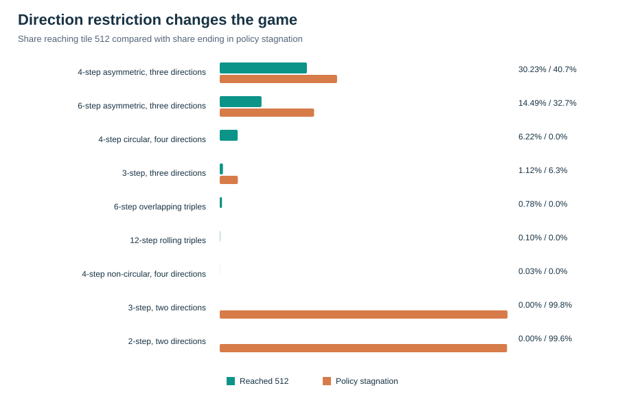

# Experiment 10: Short two-direction and three-direction cycles

## Research question

Do short repeating action words with exactly two or three directions outperform four-direction cycles? Can overlapping three-input windows, including the suggested sequence 012 then 123, improve performance? Our ultimate goal is a policy reaching tile 65536 in more than 50% of games, but these blind policies provide structural baselines, not direct contenders.

Codes: 0 up, 1 left, 2 right, 3 down. An input that leaves the board unchanged is still attempted, advances the sequence phase, consumes no random numbers and is recorded using a one-based base-36 index. The engine continues after 2048 until real game over, unless its fixed policy experiences a complete cycle of unchanged inputs, in which case the policy is irrecoverably stalled. This differs from actual game over.

## How many sequences exist?

For length L over the four directions, with exactly k distinct directions:

- Exactly two directions: C(4,2)(2^L - 2).
- Exactly three directions: C(4,3)(3^L - 3*2^L + 3).

| Length | Exactly two | Exactly three | Both |
|---:|---:|---:|---:|
| 2 | 12 | 0 | 12 |
| 3 | 36 | 24 | 60 |
| 4 | 84 | 144 | 228 |
| 5 | 180 | 600 | 780 |
| 6 | 372 | 2160 | 2532 |
| Total lengths 2 to 6 | 684 | 2928 | 3612 |

These are distinct written words, including phase shifts and repeated shorter periods, not 3612 fundamentally distinct geometric strategies. For instance 010101 has fundamental period 2. The example `012|123` uses four distinct directions across its six-input combined cycle and is counted as a separate overlapping-block family, not a three-direction-only word.

## New experimental design

184 policies across nine families. Each has 500 fresh seed values 6100 to 6599, for 92000 games. Eighty-four thousand games cover 168 new constructions; another 8000 games re-evaluate the previously strongest 16 asymmetric four-step baselines on identical fresh seeds. The 24 ordinary four-direction permutations are also replayed. All 184 policies passed exact outcome and invalid-step-log comparisons with the original engine on two seeds each (368 end-to-end crosschecks; the first 168 have 336 crosschecks). The initial faster-engine validation was done using 336 games before adding the final 16 baselines.

Families:
- 12 two-direction length-two words, e.g. 01.
- 36 two-direction length-three words, e.g. 010.
- 24 three-direction length-three words, e.g. 012.
- 24 three-direction six-step alternating-axis sweeps, e.g. 010102, where one direction occurs three times, the opposite is omitted, and the two perpendicular directions together occur three times.
- 24 overlapping three-input blocks with four total directions, e.g. 012123 (012 then 123).
- 24 rolling three-input windows with four total directions, e.g. 012123230301 (012 then 123 then 230 then 301).
- Eight four-step circular four-direction baselines.
- Sixteen four-step non-circular four-direction baselines.
- Sixteen four-step asymmetric three-direction baselines, e.g. 0102.

## Results

Total: 92000 games, 14215939 attempted inputs, 12978443 changed inputs, 1237496 unchanged inputs and 31877 policy-stagnation endings. Maximum observed tile 1024 (44 games reached it), best score 12760, zero games reached 2048 or 65536.

| Family | Patterns | Games | Mean score | Reached 512 | Reached 1024 | Stagnation |
|---|---:|---:|---:|---:|---:|---:|
| 4-step asymmetric, 3 directions | 16 | 8000 | 3776.08 | 2418 | 25 | 40.69% |
| 6-step asymmetric, 3 directions | 24 | 12000 | 3184.85 | 1739 | 19 | 32.72% |
| 4-step circular, 4 directions | 8 | 4000 | 2286.12 | 249 | 0 | 0% |
| 3-step, 3 directions | 24 | 12000 | 1673.29 | 134 | 0 | 6.29% |
| 6-step overlapping triples | 24 | 12000 | 1389.55 | 94 | 0 | 0% |
| 12-step rolling triples | 24 | 12000 | 1187.24 | 12 | 0 | 0% |
| 4-step non-circular, 4 directions | 16 | 8000 | 1087.52 | 2 | 0 | 0% |
| 3-step, 2 directions | 36 | 18000 | 127.91 | 0 | 0 | 99.79% |
| 2-step, 2 directions | 12 | 6000 | 115.11 | 0 | 0 | 99.63% |





Examples, each over 500 fresh games:

| Pattern | Mean score | Reached 512 | Reached 1024 | Stagnation |
|---|---:|---:|---:|---:|
| 01 | 128.18 | 0 | 0 | 100% |
| 012 | 1740.66 | 6 | 0 | 7.2% |
| 010102 | 3120.53 | 64 | 1 | 37.0% |
| 010201 | 3195.93 | 73 | 0 | 27.8% |
| 0102 | 3809.99 | 156 | 2 | 43.2% |
| 012123 | 827.30 | 0 | 0 | 0% |
| 012123230301 | 1034.66 | 0 | 0 | 0% |

## Same-seed statistical comparison

For each seed, average across all patterns in a family, and subtract the comparison family's mean. Because all patterns share 500 seeds, the unit of inference is the seed block, not the individual game. t-based intervals are descriptive under the independent-pseudorandom-seed approximation.

The four-step asymmetric three-direction family scores 591.22 points more per game than the six-step three-direction sweeps, with a paired 95% confidence interval [526.37, 656.08]. It has a higher class-average score on 386 of the 500 shared seeds. Compared with the circular four-direction baseline, the advantage is 1489.96 [1423.10, 1556.82], positive on 488 of 500 seeds. The comparison with three-step three-direction policies is 2102.79 [2043.46, 2162.13], positive on all 500 seed blocks. These results concern class means and fixed-policy performance, not a proven global optimum.

## Interpretation

1. **Two-direction restriction is catastrophic for blind cycles.** At least 99.6% of such games stall even when at least one of the unused directions would have a legal move. A player must have access to additional directions for recovery.
2. **Three different directions is a better starting point, but placement matters.** Every cyclic length-three word with three directions necessarily has one consecutive opposite-direction transition around its period. It therefore loses some of the perpendicular redistribution benefits of the four-step asymmetric family.
3. **Short asymmetric axis alternation is effective.** The best four-step family uses a 50% preferred-direction frequency, 25% for each perpendicular direction, zero for the preferred direction's opposite, and a 100% perpendicular transition frequency. The six-step sweeps also alternate axes but have a 50% / 33.3% / 16.7% split; the observed disadvantage is consistent with the extra imbalance, although this experiment does not isolate that feature causally.
4. **Sliding windows are not automatically helpful.** Although each block of 012|123 contains three directions, the combined cycle contains all four and introduces reversals. It loses a persistent spatial anchor. Rolling windows across all directions fare even worse.
5. **Fewer stalls do not imply better scoring.** The six-step sweeps stall less often than four-step asymmetric cycles (32.7% versus 40.7%), yet score less. The value of a fixed strategy depends on productive merging and tile organisation, not just avoiding stagnation.

## Implications for the 65536 target

No fixed word reached even 2048 in the 92000 new tests. The evidence strongly discourages spending further large simulation budgets merely enumerating longer blind cycles. It does not prove a particular fixed pattern has zero success probability.

A promising direction is a **state-dependent macro-policy**: use the efficient alternating three-direction family for normal compaction, but choose the next action using board state when the high-value tile chain is vulnerable, when congestion becomes high, or when the policy loses productive merge opportunities. Simple omitted-direction rescue on stagnation was already tested in Experiment 04 and did not achieve meaningful success, so more than a stall counter is needed.

For 65536 specifically, the research should prioritize building and converting two 32768-valued tile masses. Track the rate of reaching 32768, the conditional conversion probability from 32768 to 65536, the arrangements of other large tiles at the first 32768, and whether state-aware endgame tables can select high-success actions. The strongest published solvers are substantially above our fixed-cycle baselines; a 50% 65536 success claim requires a separate strong endgame solver and a large independent held-out validation.

## Reproduction

From the repository root:

```sh
node experiments/10-short-direction-cycles/run.js
node experiments/10-short-direction-cycles/analyze.js
node experiments/10-short-direction-cycles/figures.js
```

All original outcomes are in games-01.csv through games-07.csv, including attempted-input indices of no-op moves. Summary-part-01.csv through summary-part-04.csv contain the sequential simulation batches; summary.csv will be regenerated as part of the runner, and family-summary.csv plus analysis.json give the consolidated and seed-paired inference. The charts are dependency-free SVGs. The fast implementation uses the repository's established 2048 engine and no chosen or rerolled spawns.
